  

  
  
  
  

<table>
  <tr>
    <td width="150" align="center" valign="middle">
      
    </td>
    <td valign="middle">
      <h3>👋 Hola, soy Alejandro</h3>
      Fundo y construyo <b><a href="https://synaptic-ai.dev">Synaptic AI</a></b>: productos de inteligencia artificial que funcionan en <b>producción</b>, no solo en demos.  
      Trabajo en las dos capas de un producto de IA: la <b>técnica</b> (backend, infraestructura, agentes y pipelines de datos) y la de <b>producto</b> (qué construir, para quién y cómo se monetiza). Desde México 🇲🇽, para Latinoamérica y el mundo.
    </td>
  </tr>
</table>

## 🧠 Qué construyo

  

## 🚀 Código abierto

  
  

  Pruébalo en un minuto: <code>claude mcp add brand-kit -- uvx brand-kit-mcp --demo</code>

## 🛠️ Tecnologías

  

## 🤝 Trabajemos juntos

Me interesa colaborar en productos de IA aplicada, automatización para empresas y herramientas para agentes. Escríbeme si quieres:

- 🎯 Llevar un caso de uso de IA a **producción**, no solo a una demo.
- 🔗 Conectar tus sistemas a agentes mediante **MCP**.
- 🧩 Diseñar una arquitectura **multiagente** escalable.

  <a href="https://synaptic-ai.dev">
    <picture>
      <source media="(prefers-color-scheme: dark)" srcset="assets/synaptic-wordmark-white.png">
      
    </picture>
  </a>  
  <b>📩 <a href="mailto:alex@synaptic-ai.dev">alex@synaptic-ai.dev</a></b>

