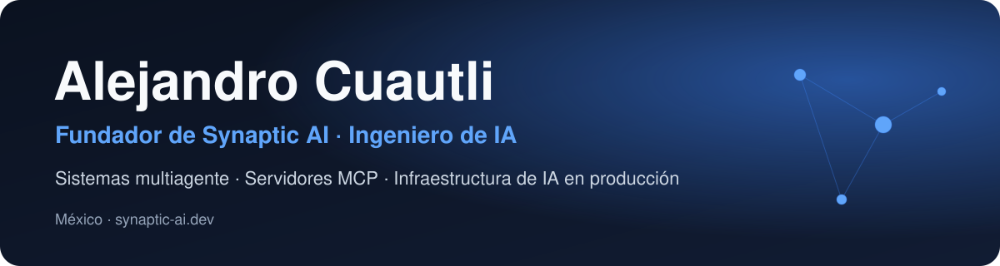

  

  
  
  
  

## 👋 Hola, soy Alejandro

Fundo y construyo **[Synaptic AI](https://synaptic-ai.dev)**: productos de inteligencia artificial que funcionan en producción, no solo en demos.

Trabajo en las dos capas de un producto de IA: la **técnica** (backend, infraestructura, agentes y pipelines de datos) y la de **producto** (qué construir, para quién y cómo se monetiza). Desde México, para Latinoamérica y el mundo.

## 🧠 Qué construyo

| | |
|---|---|
| 🤖 **Sistemas multiagente** | Agentes que planean, construyen, revisan y operan, con traspasos, memoria compartida y evidencia de cada ejecución. |
| 🔌 **Servidores MCP** | Conecto herramientas, datos e infraestructura con Claude, ChatGPT y otros agentes, con OAuth 2.1. |
| 📚 **RAG y datos** | Ingesta de documentos, embeddings y búsqueda sobre PostgreSQL con pgvector. |
| 🎙️ **IA de voz** | Agentes de voz, síntesis con clonación de voz y una central telefónica con IA. |
| 🏗️ **Infraestructura propia** | Servidores con Docker, inicio de sesión único, almacenamiento de objetos, observabilidad e integración continua. |

## 🚀 Código abierto

| Proyecto | Qué hace |
|---|---|
| [**brand-kit-mcp**](https://github.com/Alejandro-Cuautli/brand-kit-mcp) | Servidor MCP que entrega a tus agentes la identidad de tu marca (paleta, tipografía, logos y reglas) y la exporta como tokens de diseño DTCG y CSS. |
| [**Chatterbox-TTS-Server**](https://github.com/Alejandro-Cuautli/Chatterbox-TTS-Server) | Versión con mejoras para español de México: modelo ajustado es-MX, acabado de audio profesional (-18 LUFS) y detección de voz. |

## 🛠️ Tecnologías

  
  
  
  
  
  
  
  
  
  

## 🤝 Trabajemos juntos

Me interesa colaborar en productos de IA aplicada, automatización para empresas y herramientas para agentes. Escríbeme si quieres:

- 🎯 Llevar un caso de uso de IA a **producción**, no solo a una demo.
- 🔗 Conectar tus sistemas a agentes mediante **MCP**.
- 🧩 Diseñar una arquitectura **multiagente** escalable.

<b>📩 <a href="mailto:alex@synaptic-ai.dev">alex@synaptic-ai.dev</a></b>

